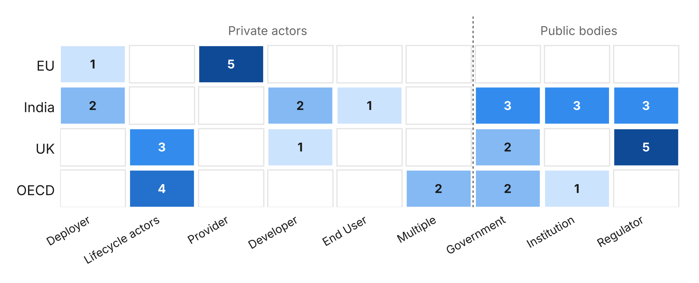
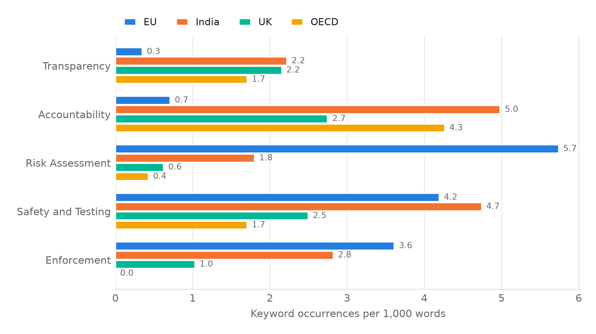

# From Principles to Enforceable Obligations: A Provision-Level Comparison of AI Governance in the European Union, India and the United Kingdom

*Suzzan Patel*

*Manuscript generated 26 November 2026 from the AI Governance Atlas dataset*

**Abstract.** Artificial intelligence governance has produced a broad consensus on principles such as transparency, accountability and safety, but far less agreement on how those principles become duties that someone must perform and that someone else can enforce. This paper compares 20 purposively selected provisions from the European Union's AI Act, India's AI Governance Guidelines and the United Kingdom's pro-innovation White Paper, using the OECD Recommendation on Artificial Intelligence as an international benchmark. Each provision is coded for legal force, obligation type, duty-holder, enforcement linkage and implementation evidence, and the manual coding is complemented by keyword analysis of the full texts. Five of the 20 provisions are mandatory, all of them in the EU sample, and five are linked to statutory sanctions. The frameworks differ less in the principles they recognise than in where they place responsibility: the binding regime addresses private providers and deployers, whereas the non-statutory frameworks mainly address governments and regulators. The paper calls this a difference in the translation chain between principle and enforcement. It also finds an inverse pattern in implementation evidence: the framework with the most enforceable duties is the one whose duties were not yet applicable during the research period. The findings describe a small structured sample and do not rank the frameworks.

*Keywords: AI governance; AI Act; comparative regulation; enforcement; India; United Kingdom; OECD*

## 1. Introduction

The last decade produced an abundance of AI principles. Governments, companies, standard-setting bodies and international organisations have published statements committing to transparent, fair, accountable and safe artificial intelligence. Mapping studies found that these documents converge on a small set of recurring values while diverging on what the values mean and how they should be implemented (Jobin, Ienca and Vayena, 2019). Critics have argued that principles alone cannot secure ethical outcomes, because AI development lacks the professional norms, proven methods and robust accountability mechanisms that make principles operative in fields such as medicine (Mittelstadt, 2019).

That critique raises an empirical question for regulators rather than ethicists. When a jurisdiction moves from endorsing a principle to governing AI, what exactly changes? A principle may become a statutory duty with a named duty-holder and a sanction; it may become guidance that existing regulators are invited to apply; or it may remain a recommendation whose only follow-up is periodic reporting. These are different regulatory techniques, and they carry different implications for whether the principle will shape conduct.

This paper examines that translation in three jurisdictions that have taken visibly different routes. The European Union adopted a horizontal, risk-based regulation, the AI Act, and amended it in 2026 through the Digital Omnibus on AI. The United Kingdom chose a principles-based framework applied by existing sectoral regulators without new primary legislation. India issued national AI Governance Guidelines in November 2025 that favour voluntary measures, existing law and new coordinating institutions. The OECD Recommendation on Artificial Intelligence, to which all three relate, serves as an international benchmark rather than as a fourth jurisdiction.

The three cases were chosen because they vary the variable of interest while holding the underlying principles roughly constant. All three jurisdictions adhere to, or draw explicitly on, the OECD principles, so differences between them are unlikely to reflect disagreement about values. They differ instead in regulatory technique: a dedicated statute with product-safety style compliance machinery, a non-statutory principles regime delivered through existing regulators, and a guidelines-led approach that combines voluntary measures with institution building and reliance on existing legislation. India also extends the comparison beyond the EU-UK pairing that dominates much commentary, adding a large jurisdiction whose approach is explicitly framed around enabling innovation and adoption.

The central research question is: to what extent do the EU, India and the UK translate AI governance principles into specific, measurable and enforceable regulatory obligations? The paper contributes in three ways. First, it offers a provision-level coding scheme that separates the legal force of an instrument from the force of an individual duty, the duty-holder, the enforcement route and the evidence of implementation. Second, it applies that scheme to a transparent and reproducible evidence base in which every coded record carries its exact text, page reference and source version. Third, it uses the comparison to identify two patterns, concerning the addressees of obligations and the timing of implementation, that a principle-by-principle comparison would miss.

## 2. Analytical framework: the translation chain

The analysis treats the movement from principle to practice as a chain of five links. A break at any link limits how far a principle can be relied upon to change behaviour, and the links are deliberately coded separately so that strength at one point is not mistaken for strength throughout.

**Legal force** concerns the instrument: whether it is binding legislation, government policy, non-binding guidance or an international recommendation. **Obligation force** concerns the individual provision: whether it imposes a mandatory requirement, makes a recommendation, or assigns a function to an institution. A binding instrument can contain recommendations, and a policy document can describe obligations that already exist elsewhere in law, so the two must be distinguished.

The **duty-holder** link identifies who is expected to act. A provision addressed to an AI provider creates a different regulatory relationship from one addressed to a ministry or a sectoral regulator, even where both concern the same principle. The **enforcement linkage** link asks whether a compliance route attaches to the duty. The coding distinguishes five situations: a route named in the provision itself (direct); a route attached by cross-reference to sanctions elsewhere in the instrument (cross-referenced); reliance on the general powers of existing bodies without a provision-specific route (system-level only); no identified route; and provisions that build institutions rather than impose compliance duties (not applicable).

The final link, **implementation evidence**, records whether dated and attributable sources show that the measure has been put into operation. It is coded on a five-point scale from implemented to not assessed, and absence of located evidence is never treated as proof of non-implementation. Effectiveness, meaning whether a measure changed conduct or reduced harm, lies outside the chain and outside this study.

## 3. Data and methods

### 3.1 Sources and versions

The corpus consists of one primary instrument per framework, listed with the version coded in Table 1. For the EU, the coding uses the consolidated text that incorporates Regulation (EU) 2026/1744; because several high-risk obligations were deferred by that amendment, all five EU provisions are recorded as legally adopted but not yet applicable. The UK White Paper and the India Guidelines are coded in the versions published by their issuing departments, and the OECD Recommendation as revised in May 2024.

*Table 1. Primary instruments and versions coded.*

| Framework | Instrument | Version coded | Legal status |
|---|---|---|---|
| EU | Regulation (EU) 2024/1689 (Artificial Intelligence Act), as amended by Regulation (EU) 2026/1744 (Digital Omnibus on AI) | Consolidated EU AI Act, 27 July 2026 | Binding legislation |
| India | India AI Governance Guidelines: Enabling Safe and Trusted AI Innovation (MeitY, IndiaAI Mission, 5 November 2025) | India AI Governance Guidelines, MeitY, 5 November 2025 (68-page PDF) | Non-binding guidance |
| UK | A pro-innovation approach to AI regulation (DSIT White Paper, CP 815, March 2023; amended version) | CP 815 amended web-ready PDF (with correction slip to Annex C; GOV.UK page updated 3 August 2023) | Government policy (non-statutory) |
| OECD | Recommendation of the Council on Artificial Intelligence, OECD/LEGAL/0449 (adopted 22 May 2019; revised 8 November 2023 and 3 May 2024) | OECD/LEGAL/0449 as revised 3 May 2024 (PDF edition © OECD 2026, 12 pp.) | International recommendation (non-binding) |

### 3.2 Sample and coding

The evidence base contains 20 provisions, five from the EU, five from India, five from the UK and five from the OECD benchmark. Provisions were selected purposively for their relevance to five governance dimensions: transparency, accountability, risk assessment, safety and testing, and enforcement. Each record contains the verbatim text, the article or section, PDF and printed page references, the duty-holder in the source's own terminology, the enforcement route with cross-references, and dated implementation evidence. Equal numbers per framework support balanced descriptive tables but do not imply that the frameworks are of equal scope or that the sample represents each framework as a whole.

Coding followed a written framework that defines each category and its decision rules, including the rule that aspirational language is not coded as a mandatory obligation and that a sanction located elsewhere in an instrument is recorded as cross-referenced rather than direct. Duty-holders and enforcement mechanisms were then normalised into standard categories, allowing a provision to belong to more than one. A structured audit checked identifiers, missing values and category distributions, and a source-validation register links every record to its official publication.

Every record was then checked against its primary source. The verification audit comprises 180 field-level checks across 9 coded fields: 140 were verified as recorded, 37 led to a correction and 3 were verified with a caveat; all 37 corrections have been made in the dataset analysed here and are logged in a correction register so that each can be formally signed off with a recorded reason. All corrections had been signed off at the time of generation. None of the corrections changes a classification category used in the analysis; they concern descriptive and referencing fields, chiefly verification notes (16), enforcement mechanism (10) and source reference (5).

### 3.3 Computational indicators

To complement the manual coding, the full text of each instrument was extracted page by page and searched for dimension-related keyword families, with counts normalised per 1,000 words. The extracted EU text is the consolidated version without recitals (63,425 words), compared with 16,659 words for India, 32,029 for the UK and 4,689 for the OECD. Keyword frequencies are treated strictly as descriptive indicators of emphasis in drafting. They cannot show whether a term creates an obligation, and they are sensitive to vocabulary that is specific to one instrument.

## 4. Findings

### 4.1 Legal force and obligation force

Table 2 summarises the translation profile of each framework. The sharpest division is in obligation force. All five mandatory provisions in the sample come from the EU, where 100% of coded provisions impose requirements on identified actors. The remaining 15 provisions are either recommendations (10) or institutional assignments (5), spread across India, the UK and the OECD benchmark.

*Table 2. Translation profile by framework (number of coded provisions). † Direct or cross-referenced enforcement linkage. ‡ Implemented or partially implemented.*

| Framework | Provisions | Mandatory | Recommended | Institutional | Compliance route † | System-level only | Implementation evidence ‡ |
|---|---|---|---|---|---|---|---|
| EU | 5 | 5 | 0 | 0 | 5 | 0 | 0 |
| India | 5 | 0 | 3 | 2 | 1 | 1 | 3 |
| UK | 5 | 0 | 3 | 2 | 1 | 3 | 5 |
| OECD | 5 | 0 | 4 | 1 | 0 | 1 | 1 |

The difference is not simply that one instrument is a statute. The UK and Indian provisions are frequently precise about what good practice looks like: the UK transparency principle (UK001) describes proportionate explainability in some detail, and the India Guidelines recommend transparency reports assessing risks of harm in the Indian context (IND001). What they lack is the grammar of obligation: an addressee who must act and a consequence if it does not. Conversely, the EU provisions are written in the passive voice, and their duty-holder is established only by reading them with Article 16, which obliges providers to ensure compliance with the requirements of Chapter III, Section 2. Obligation force therefore depends on the architecture of the instrument as well as on the wording of a single provision.

### 4.2 Who is obliged? The addressees of governance

Figure 1 shows the actors to whom each framework's provisions are addressed. In the EU sample, all five provisions place duties on private actors (providers, and in EU004 also deployers) and none address public bodies. The UK pattern is close to the reverse: regulators appear in all five UK provisions, and two provisions are addressed to public bodies alone. India's sample is the most institutionally oriented, with four of five provisions addressed to government, regulators or new institutions such as the AI Safety Institute and the AI Governance Group.

*Figure 1. Duty-holders named in the coded provisions, by framework. Cells show the number of provisions that address each actor category; a provision can address more than one. Darker cells indicate more provisions.*

This difference matters for the translation chain. A principle addressed to a regulator is translated into conduct only after a second step, when the regulator issues guidance, rules or decisions of its own. A principle addressed to a provider skips that step. The non-statutory frameworks are therefore not merely softer versions of the EU model; they are structured as instructions to the state about how to govern, with obligations on industry left to existing sectoral law or to a later stage. The OECD benchmark sits between the two: it addresses AI actors generally in four of its five provisions, but only through recommendations to adhering governments.

### 4.3 Enforcement linkage

Figure 2 reports the enforcement linkage of each provision. Seven of the 20 provisions have a compliance route that is either named in the provision or attached to it by cross-reference. Five of these are the EU provisions, each linked through Article 16 to administrative fines under Article 99, supported by conformity assessment and market surveillance; EU004 additionally links deployer duties to fines through Article 26.

*Figure 2. Enforcement linkage of coded provisions, by framework. Cross-referenced: duty linked to statutory sanctions elsewhere in the instrument. System-level only: reliance on the general powers of existing bodies. Direct: mechanism named in the provision. Not applicable (hatched): institution-building rather than a compliance duty.*

The direct linkages outside the EU are qualitatively different from the EU's statutory route. In India, the only direct linkage (IND001) is a soft-accountability route: voluntary transparency reporting and peer scrutiny, with no sanction for non-publication. In the UK, the direct linkage (UK005) consists of the existing statutory powers of sectoral regulators, applied to the principles during an initial non-statutory period. Across the non-EU frameworks, the most common outcome is reliance on system-level powers (five provisions) or no identified route (six). Two provisions are coded as not applicable because they create institutional functions, such as the UK's cross-sectoral risk assessment function and India's planned risk classification framework, rather than compliance duties.

System-level reliance should not be read as an absence of enforcement. The UK model deliberately routes enforcement through regulators that already hold statutory powers, and India's Guidelines assign enforcement to sectoral bodies such as financial and telecommunications regulators. The point is that the link between a specific AI principle and a specific sanction is indirect: it depends on whether a sector regulator's existing mandate covers the conduct, and on that regulator choosing to act. For the OECD benchmark, the only follow-up mechanism in the sample is reporting by the Digital Policy Committee to the OECD Council, which monitors implementation but does not enforce it.

### 4.4 Implementation evidence

Figure 3 reports the implementation evidence recorded for each provision. The pattern is the reverse of the enforcement pattern. None of the five EU provisions has an implementation assessment, because their obligations were adopted but not yet applicable during the research period; harmonised standards and the deferred application dates mean that compliance cannot yet be observed. By contrast, all five UK provisions show at least partial implementation, documented mainly through the government's 2024 response and regulators' published approaches, and three of five Indian provisions show partial implementation, chiefly through institutional steps such as the creation of the IndiaAI Safety Institute.

*Figure 3. Implementation evidence recorded for coded provisions, by framework. Outlined segments are provisions not assessed, which is not a finding of non-implementation.*

This inverse relationship has a straightforward explanation, and it is itself a finding about the translation chain. Measures addressed to the state, such as creating an institution or publishing guidance, can be implemented quickly and documented in official sources. Measures addressed to industry under a statute require standards, designated authorities and transition periods before they bite. Where Indian measures do depend on industry or on new legal obligations (IND001, IND002), the recorded evidence is weakest. Implementation evidence therefore needs to be read alongside the addressee of each duty: early implementation of institution-building provisions does not show that private conduct has changed.

### 4.5 Principle by principle

Reading the sample by governance dimension shows how the same principle is expressed in different regulatory forms. The paragraphs below take each dimension in turn, using the coded summary of each provision.

*Transparency* is the primary dimension of four provisions. In the EU (EU003), high-risk AI systems must be transparent enough for deployers to interpret their outputs and use them appropriately. In India (IND001), anyone developing or deploying AI systems in India is advised to publish transparency reports that assess the risk of harm their systems pose to individuals and society in the Indian context. In the UK (UK001), AI systems should be transparent and explainable to a degree proportionate to their risk. In the OECD benchmark (OECD001), AI actors should commit to transparency and responsible disclosure. Only the EU frames this dimension as a mandatory duty; in India, the UK and the OECD benchmark it takes the form of recommendations or institutional functions.

*Accountability* is the primary dimension of four provisions. In the EU (EU004), high-risk AI systems must be designed so that natural persons can effectively oversee them while in use, with the aim of preventing or minimising risks to health, safety or fundamental rights. In India (IND002), the Guidelines recommend clarifying how each actor in the AI value chain (developers, deployers, end-users) is governed under existing law such as the IT Act, and then imposing obligations on each that match its function and the risk of harm (for example transparency reporting, content removal, grievance redressal and legal assistance). In the UK (UK002), organisations across the AI life cycle should have governance measures ensuring effective oversight of how AI systems are supplied and used, with clear lines of accountability. In the OECD benchmark (OECD002), AI actors should be accountable for the proper functioning of AI systems and for respecting the OECD principles, according to their roles and context. Only the EU frames this dimension as a mandatory duty; in India, the UK and the OECD benchmark it takes the form of recommendations or institutional functions.

*Risk Assessment* is the primary dimension of five provisions. In the EU (EU001), providers must run a documented, continuous and iterative risk management process across the whole lifecycle of a high-risk AI system. In the EU (EU002), high-risk AI systems trained on data must be developed using training, validation and testing data sets that meet quality criteria. In India (IND003), the Guidelines recommend developing an India-specific framework for assessing and classifying AI risks, based on real-world evidence of harm and reflecting India's social, economic and cultural context, including risks to vulnerable groups such as children and women. In the UK (UK003), central government is to run a cross-sectoral risk assessment function. In the OECD benchmark (OECD003), AI actors should apply a systematic, ongoing risk management approach to every phase of the AI lifecycle, according to their role, context and ability to act, and adopt responsible business conduct, including by cooperating with suppliers, users and other stakeholders. Only the EU frames this dimension as a mandatory duty; in India, the UK and the OECD benchmark it takes the form of recommendations or institutional functions.

*Safety and Testing* is the primary dimension of four provisions. In the EU (EU005), high-risk AI systems must achieve appropriate accuracy, robustness and cybersecurity and keep performing consistently throughout their lifecycle. In India (IND004), the AI Safety Institute (AISI) is to be the main body guiding safe and trusted AI in India. In the UK (UK004), AI systems should be robust, secure and safe throughout their life cycle, and risks should be continually identified, assessed and managed. In the OECD benchmark (OECD004), AI systems should be robust, secure and safe throughout their lifecycle, working appropriately and without unreasonable safety or security risks under normal use, foreseeable use or misuse, or adverse conditions. Only the EU frames this dimension as a mandatory duty; in India, the UK and the OECD benchmark it takes the form of recommendations or institutional functions.

*Enforcement* is the primary dimension of three provisions. In India (IND005), enforcement is left to existing sectoral agencies and regulators, each within its own domain; for example, the Ministry of Finance and RBI for financial services. In the UK (UK005), existing regulators apply the five principles within their current remits, using their existing powers and resources, during an initial non-statutory period. In the OECD benchmark (OECD005), the OECD Council instructs its Digital Policy Committee, through the Working Party on AI Governance, to report on how the Recommendation is being implemented, disseminated and kept relevant. None of the provisions coded under this dimension is mandatory; all take the form of recommendations or institutional functions. The EU sample has no provision coded primarily under this dimension because enforcement attaches to its duties by cross-reference rather than through separate provisions, which reflects the selection of provisions rather than the content of the framework.

### 4.6 Computational indicators

Figure 4 reports keyword frequencies. The EU text has the highest density of risk-assessment vocabulary (5.7 occurrences per 1,000 words) and of enforcement vocabulary (3.6), consistent with its compliance architecture. Both the India and UK texts are dominated by accountability vocabulary, and the OECD Recommendation contains no enforcement terms at all.

*Figure 4. Frequency of dimension-related keyword families per 1,000 words in the full text of each instrument. The EU figure uses the consolidated text without recitals. Frequencies indicate drafting emphasis, not legal effect.*

These indicators agree with the manual coding at the level of broad emphasis, but they also show the limits of lexical methods. Part of the EU's risk-assessment score reflects the term 'high-risk', which is a defined category in the Act rather than evidence of a risk-assessment duty, and the accountability scores for India and the UK are inflated by general uses of 'responsible'. Keyword density measures how often a framework talks about a principle; only provision-level reading establishes whether it turns that principle into a duty.

## 5. Discussion

The comparison supports three observations about how AI principles are translated into governance.

First, the frameworks share principles but differ in where the chain of translation runs. The OECD benchmark, the UK principles and the India sutras all recognise transparency, accountability and safety, and the EU requirements operationalise the same values. The decisive differences lie further down the chain: in obligation force, in the addressee of the duty and in the presence of a provision-specific route to a sanction. Comparisons that stop at the level of principles will therefore overstate convergence, a point consistent with the observation that consensus on high-level values can conceal deep disagreement about implementation (Mittelstadt, 2019).

Second, the non-statutory frameworks are best understood as delegations of translation rather than as weaker statements of obligation. The UK framework asks regulators to interpret and apply cross-cutting principles within their remits; the India Guidelines ask ministries, sectoral regulators and new coordinating bodies to clarify how existing law applies to actors in the AI value chain and to develop risk frameworks. In both, the step that turns a principle into a duty on industry is postponed and distributed. This preserves flexibility and avoids premature rules for a fast-moving technology, but it makes outcomes depend on regulators' capacity, mandates and willingness to act, and it can leave gaps where conduct falls between sectors.

Third, legal enforceability and early implementation pulled in opposite directions during the research period. The EU has the most complete chain on paper, with mandatory duties, named duty-holders and cross-referenced sanctions, but its high-risk obligations had not yet become applicable, and their entry into application was deferred by the 2026 amendment. Commentators had already questioned whether parts of the Act's enforcement design would achieve their aims (Veale and Zuiderveen Borgesius, 2021). The UK and India show more documented implementation, but of measures addressed mainly to the state. Neither pattern establishes which approach will better protect people affected by AI; they show that enforceability and implementation must be assessed separately and over time.

The coding also indicates where each framework's chain is weakest. For the EU, whose sampled duties are fully linked to enforcement but not yet applicable, the weakest link is implementation: the priority is timely harmonised standards, designated authorities and early reporting on conformity assessment and market surveillance. For India, where several sampled provisions have no identified enforcement route, the weakest link is the duty-holder: the recommended clarification of obligations across the AI value chain is the step on which the rest of the chain depends, and a published timetable for it would allow progress to be tracked. For the UK, where most sampled provisions rely on the general powers of existing regulators, the weakest link is the connection between principle and sanction: a public map of which regulator's powers cover which principle, and a statement of how gaps between sectors are handled, would make that link visible. These are inferences from a small sample and are offered as hypotheses for fuller study rather than as evaluations of the frameworks.

For researchers, the implication is methodological. Coding legal force, obligation force, duty-holder, enforcement linkage and implementation as separate variables reveals patterns that a single measure of regulatory strength would hide. For policymakers, the comparison suggests that the credibility of a principles-based approach depends on the second step of translation, which deserves the same transparency and monitoring as the principles themselves.

## 6. Limitations

The study has important limitations. The sample of 20 provisions is purposive, and its five-per-framework design supports structured comparison, not statistical generalisation. A provision absent from the sample may exist elsewhere in a framework, and a fuller sample could change the patterns observed. The coding was carried out by a single researcher under a written framework; inter-coder reliability has not yet been measured.

The instruments also differ in date, length, legal character and purpose. Later developments are outside the coded versions, including India's Information Technology (Intermediary Guidelines and Digital Media Ethics Code) Amendment Rules, 2026, which brought synthetically generated content within binding intermediary obligations from February 2026; such developments may change the binding status of parts of a framework that this sample codes as non-binding. Implementation evidence depends on what official sources publish and was assessed at a single point in time. Finally, the computational indicators are sensitive to extraction quality and instrument-specific vocabulary and should be read only as descriptive context.

## 7. Conclusion

AI governance principles are widely shared; their translation into enforceable obligations is not. In this provision-level comparison, mandatory duties and statutory sanctions were confined to the EU, while the UK and India relied on regulators, institutions and existing law to complete the translation, and the OECD benchmark relied on reporting. The most informative differences lay not in which principles each framework endorses but in who is obliged to act, whether a route to enforcement attaches to the duty, and whether evidence shows the measure in operation. Tracing those links, provision by provision, offers a more precise basis for comparing AI governance than counting principles, and a clearer view of where the gap between principle and practice actually lies.

## Data and code availability

The coded dataset, source PDFs, analysis scripts and the generator for this manuscript are available in the AI Governance Atlas repository. All figures and counts in this paper are produced from the dataset by *run_pipeline.py*; re-running the pipeline regenerates the manuscript. The generated text is a data-driven draft: legal statements should be checked against the primary sources cited below before publication.

## References

### Primary sources

- Regulation (EU) 2024/1689 (Artificial Intelligence Act), as amended by Regulation (EU) 2026/1744 (Digital Omnibus on AI). Version coded: Consolidated EU AI Act, 27 July 2026. Available at: https://eur-lex.europa.eu/eli/reg/2024/1689/2026-07-27/eng/pdf
- India AI Governance Guidelines: Enabling Safe and Trusted AI Innovation (MeitY, IndiaAI Mission, 5 November 2025). Version coded: India AI Governance Guidelines, MeitY, 5 November 2025 (68-page PDF). Available at: https://static.pib.gov.in/WriteReadData/specificdocs/documents/2025/nov/doc2025115685601.pdf
- A pro-innovation approach to AI regulation (DSIT White Paper, CP 815, March 2023; amended version). Version coded: CP 815 amended web-ready PDF (with correction slip to Annex C; GOV.UK page updated 3 August 2023). Available at: https://www.gov.uk/government/publications/ai-regulation-a-pro-innovation-approach
- Recommendation of the Council on Artificial Intelligence, OECD/LEGAL/0449 (adopted 22 May 2019; revised 8 November 2023 and 3 May 2024). Version coded: OECD/LEGAL/0449 as revised 3 May 2024 (PDF edition © OECD 2026, 12 pp.). Available at: https://legalinstruments.oecd.org/en/instruments/OECD-LEGAL-0449

### Literature

- Jobin, A., Ienca, M. and Vayena, E. (2019) 'The global landscape of AI ethics guidelines', Nature Machine Intelligence, 1(9), pp. 389-399. doi:10.1038/s42256-019-0088-2.
- Mittelstadt, B. (2019) 'Principles alone cannot guarantee ethical AI', Nature Machine Intelligence, 1(11). doi:10.1038/s42256-019-0114-4.
- Veale, M. and Zuiderveen Borgesius, F. (2021) 'Demystifying the Draft EU Artificial Intelligence Act', Computer Law Review International, 22(4), pp. 97-112. doi:10.9785/cri-2021-220402.

## Appendix

*Table A1. The coded provisions.*

| ID | Provision | Dimension | Obligation | Enforcement linkage | Implementation |
|---|---|---|---|---|---|
| EU001 | Article 9(1)-(9) (Chapter III, Section 2) – Risk management system | Risk Assessment | Mandatory | Cross-referenced | Not assessed |
| EU002 | Article 10(1)-(4), (6) (Chapter III, Section 2) – Data and data governance; read with Article 4a(1) | Risk Assessment | Mandatory | Cross-referenced | Not assessed |
| EU003 | Article 13(1)-(3) (Chapter III, Section 2) – Transparency and provision of information to deployers | Transparency | Mandatory | Cross-referenced | Not assessed |
| EU004 | Article 14(1)-(4) (Chapter III, Section 2) – Human oversight | Accountability | Mandatory | Cross-referenced | Not assessed |
| EU005 | Article 15(1), (3)-(5) (Chapter III, Section 2) – Accuracy, robustness and cybersecurity | Safety and Testing | Mandatory | Cross-referenced | Not assessed |
| IND001 | Part 4 – Practical Guidelines for Industry & Regulators; 'Guidelines for industry', bullet 5 (transparency reports) | Transparency | Recommended | Direct | No evidence found |
| IND002 | Part 2, §2.5 Accountability – Recommendations, bullet 2 (proportionate obligations across the AI value chain); read with 'Liability' (graded liability) | Accountability | Recommended | None identified | Not yet implemented |
| IND003 | Part 2, §2.4 Risk Mitigation – Recommendations, bullet 1 (India-specific risk assessment and classification framework) | Risk Assessment | Recommended | Not applicable | Partially implemented |
| IND004 | Part 2, §2.6 Institutions – B. AI Safety Institute (functions) | Safety and Testing | Institutional | None identified | Partially implemented |
| IND005 | Part 2, §2.6 Institutions – whole-of-government approach, bullet 1 (sectoral regulators lead on enforcement) | Enforcement | Institutional | System-level only | Partially implemented |
| UK001 | Part 3, §3.2.3 A principles-based approach – Principle: Appropriate transparency and explainability | Transparency | Recommended | System-level only | Partially implemented |
| UK002 | Part 3, §3.2.3 – Principle: Accountability and governance; read with §3.3.2 Government's role in addressing accountability across the life cycle (paras 80-83) | Accountability | Recommended | System-level only | Partially implemented |
| UK003 | Part 3, §3.3.1 New central functions to support the framework – Box 3.1 (Functions required to support implementation of the framework): Cross-sectoral risk assessment (Activities, bullet 1) | Risk Assessment | Institutional | Not applicable | Partially implemented |
| UK004 | Part 3, §3.2.3 – Principle: Safety, security and robustness | Safety and Testing | Recommended | System-level only | Partially implemented |
| UK005 | Part 3, §3.2.4 Our preferred model for applying the principles – para 55 (read with paras 56-59) | Enforcement | Institutional | Direct | Partially implemented |
| OECD001 | Section 1, Principle 1.3 Transparency and explainability (i)-(iv) | Transparency | Recommended | None identified | Not assessed |
| OECD002 | Section 1, Principle 1.5 Accountability, paragraphs (a)-(b) | Accountability | Recommended | None identified | Not assessed |
| OECD003 | Section 1, Principle 1.5 Accountability, paragraph (c) (systematic risk management) | Risk Assessment | Recommended | None identified | Not assessed |
| OECD004 | Section 1, Principle 1.4 Robustness, security and safety, paragraphs (a)-(c) | Safety and Testing | Recommended | None identified | Not assessed |
| OECD005 | Section VIII (instructions to the Digital Policy Committee), point (d); read with points (a)-(c) | Enforcement | Institutional | System-level only | Implemented |
