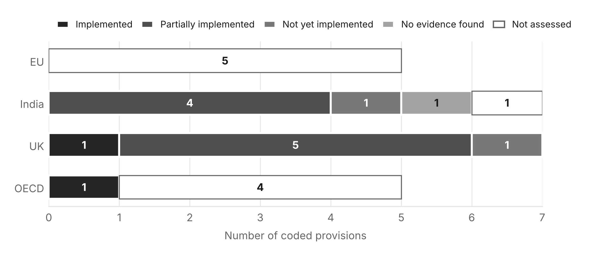

# From Principles to Enforceable Obligations: A Provision-Level Comparison of AI Governance in the European Union, India and the United Kingdom

*Suzzan Patel*

*Manuscript generated 26 November 2026 from the AI Governance Atlas dataset*

**Abstract.** Artificial intelligence governance has produced a broad consensus on principles such as transparency, accountability and safety, but far less agreement on how those principles become duties that someone must perform and that someone else can enforce. This paper compares 24 purposively selected provisions from the European Union's AI Act, India's AI Governance Guidelines and its 2026 intermediary rules on synthetically generated information, and the United Kingdom's pro-innovation White Paper and the government's 2024 response, using the OECD Recommendation on Artificial Intelligence as an international benchmark. Each provision is coded for legal force, obligation force and nature, duty-holder, enforcement linkage and implementation evidence, and the manual coding is complemented by keyword analysis and an AI-assisted blind second coding. Seven of the 24 provisions come from binding instruments, in the EU and India, and seven are linked to statutory sanctions. The frameworks differ less in the principles they recognise than in where they place responsibility: every binding provision addresses private providers, deployers or intermediaries, whereas non-binding provisions mainly address governments and regulators. The paper calls this a difference in the translation chain between principle and enforcement. It also finds that enforceability and implementation diverge: the EU's statutory duties were not yet applicable during the research period, while India's targeted intermediary duties took effect within days by building on an existing due-diligence regime. The findings describe a small structured sample and do not rank the frameworks.

*Keywords: AI governance; AI Act; comparative regulation; enforcement; India; United Kingdom; OECD*

## 1. Introduction

The last decade produced an abundance of AI principles. Governments, companies, standard-setting bodies and international organisations have published statements committing to transparent, fair, accountable and safe artificial intelligence. Mapping studies found that these documents converge on a small set of recurring values while diverging on what the values mean and how they should be implemented (Jobin, Ienca and Vayena, 2019). Critics have argued that principles alone cannot secure ethical outcomes, because AI development lacks the professional norms, proven methods and robust accountability mechanisms that make principles operative in fields such as medicine (Mittelstadt, 2019).

That critique raises an empirical question for regulators rather than ethicists. When a jurisdiction moves from endorsing a principle to governing AI, what exactly changes? A principle may become a statutory duty with a named duty-holder and a sanction; it may become guidance that existing regulators are invited to apply; or it may remain a recommendation whose only follow-up is periodic reporting. These are different regulatory techniques, and they carry different implications for whether the principle will shape conduct.

This paper examines that translation in three jurisdictions that have taken visibly different routes. The European Union adopted a horizontal, risk-based regulation, the AI Act, and amended it in 2026 through the Digital Omnibus on AI. The United Kingdom chose a principles-based framework applied by existing sectoral regulators without new primary legislation, and confirmed that approach in its February 2024 response to consultation. India issued national AI Governance Guidelines in November 2025 that favour voluntary measures, existing law and new coordinating institutions, and three months later brought synthetically generated content within its binding rules for online intermediaries. The OECD Recommendation on Artificial Intelligence, to which all three relate, serves as an international benchmark rather than as a fourth jurisdiction.

The three cases were chosen because they vary the variable of interest while holding the underlying principles roughly constant. All three jurisdictions adhere to, or draw explicitly on, the OECD principles, so differences between them are unlikely to reflect disagreement about values. They differ instead in regulatory technique: a dedicated statute with product-safety style compliance machinery, a non-statutory principles regime delivered through existing regulators, and a guidelines-led approach that combines voluntary measures with institution building and reliance on existing legislation. India also extends the comparison beyond the EU-UK pairing that dominates much commentary, adding a large jurisdiction whose approach is explicitly framed around enabling innovation and adoption.

The central research question is: to what extent do the EU, India and the UK translate AI governance principles into specific, measurable and enforceable regulatory obligations? The paper contributes in three ways. First, it offers a provision-level coding scheme that separates the legal force of an instrument from the force of an individual duty, the duty-holder, the enforcement route and the evidence of implementation. Second, it applies that scheme to a transparent and reproducible evidence base in which every coded record carries its exact text, page reference and source version. Third, it uses the comparison to identify two patterns, concerning the addressees of obligations and the timing of implementation, that a principle-by-principle comparison would miss.

## 2. Analytical framework: the translation chain

The analysis treats the movement from principle to practice as a chain of five links. A break at any link limits how far a principle can be relied upon to change behaviour, and the links are deliberately coded separately so that strength at one point is not mistaken for strength throughout.

**Legal force** concerns the instrument: whether it is binding legislation, government policy, non-binding guidance or an international recommendation. **Obligation force** concerns the individual provision: whether it imposes a mandatory requirement, makes a recommendation, or assigns a function to an institution. A binding instrument can contain recommendations, and a policy document can describe obligations that already exist elsewhere in law, so the two must be distinguished.

The **duty-holder** link identifies who is expected to act. A provision addressed to an AI provider creates a different regulatory relationship from one addressed to a ministry or a sectoral regulator, even where both concern the same principle. The **enforcement linkage** link asks whether a compliance route attaches to the duty. The coding distinguishes five situations: a route named in the provision itself (direct); a route attached by cross-reference to sanctions elsewhere in the instrument (cross-referenced); reliance on the general powers of existing bodies without a provision-specific route (system-level only); no identified route; and provisions that build institutions rather than impose compliance duties (not applicable).

The final link, **implementation evidence**, records whether dated and attributable sources show that the measure has been put into operation. It is coded on a five-point scale from implemented to not assessed, and absence of located evidence is never treated as proof of non-implementation. Effectiveness, meaning whether a measure changed conduct or reduced harm, lies outside the chain and outside this study.

## 3. Data and methods

### 3.1 Sources and versions

The corpus consists of a principal instrument for each framework, supplemented by two later instruments for India and the UK, listed with the version coded in Table 1. For the EU, the coding uses the consolidated text that incorporates Regulation (EU) 2026/1744; because several high-risk obligations were deferred by that amendment, all five EU provisions are recorded as legally adopted but not yet applicable. The UK White Paper and the India Guidelines are coded in the versions published by their issuing departments, and the OECD Recommendation as revised in May 2024. The later instruments were added so that the sample reflects how each framework developed after its principal instrument: India's 2026 amendment of the intermediary rules, which created the country's first binding obligations aimed at AI-generated content, and the UK government's 2024 consultation response.

*Table 1. Instruments and versions coded. The first instrument listed for each framework is its principal instrument.*

| Framework | Instrument | Version coded | Legal status | Provisions |
|---|---|---|---|---|
| EU | Regulation (EU) 2024/1689 (Artificial Intelligence Act), as amended by Regulation (EU) 2026/1744 (Digital Omnibus on AI) | Consolidated EU AI Act, 27 July 2026 | Binding legislation | 5 |
| India | India AI Governance Guidelines: Enabling Safe and Trusted AI Innovation (MeitY, IndiaAI Mission, 5 November 2025) | India AI Governance Guidelines, MeitY, 5 November 2025 (68-page PDF) | Non-binding guidance | 5 |
| India | Information Technology (Intermediary Guidelines and Digital Media Ethics Code) Rules, 2021, as amended by the Information Technology (Intermediary Guidelines and Digital Media Ethics Code) Amendment Rules, 2026 (G.S.R. 120(E), 10 February 2026) | Consolidated text published by MeitY, 'updated as on 10.02.2026' (amendments by G.S.R. 120(E), in force 20 February 2026; corrigenda 26 February 2026). A … | Binding legislation | 2 |
| UK | A pro-innovation approach to AI regulation (DSIT White Paper, CP 815, March 2023; amended version) | CP 815 amended web-ready PDF (with correction slip to Annex C; GOV.UK page updated 3 August 2023) | Government policy (non-statutory) | 5 |
| UK | A pro-innovation approach to AI regulation: government response to consultation (DSIT, CP 1019, 6 February 2024) | CP 1019, February 2024 (amended web-ready PDF) | Government policy (non-statutory) | 2 |
| OECD | Recommendation of the Council on Artificial Intelligence, OECD/LEGAL/0449 (adopted 22 May 2019; revised 8 November 2023 and 3 May 2024) | OECD/LEGAL/0449 as revised 3 May 2024 (PDF edition © OECD 2026, 12 pp.) | International recommendation (non-binding) | 5 |

### 3.2 Sample and coding

The evidence base contains 24 provisions, five from the EU, seven from India, seven from the UK and five from the OECD benchmark. Provisions were selected purposively for their relevance to five governance dimensions: transparency, accountability, risk assessment, safety and testing, and enforcement. Each record contains the verbatim text, the article or section, PDF and printed page references, the duty-holder in the source's own terminology, the enforcement route with cross-references, and dated implementation evidence. The principal instruments contribute five provisions each; the later instruments add four more. The counts support structured description but do not imply that the frameworks are of equal scope or that the sample represents each framework as a whole.

Coding followed a written framework that defines each category and its decision rules, including the rule that aspirational language is not coded as a mandatory obligation and that a sanction located elsewhere in an instrument is recorded as cross-referenced rather than direct. Obligation force (mandatory, recommended, voluntary or not specified) is coded separately from obligation nature (institutional, procedural, substantive, reporting or other), so that a provision assigning a task to an institution is not mistaken for a weaker form of duty. Duty-holders and enforcement mechanisms were then normalised into standard categories, allowing a provision to belong to more than one. A structured audit checked identifiers, missing values and category distributions, and a source-validation register links every record to its official publication.

Every record was then checked against its primary source. The verification audit comprises 180 field-level checks across 9 coded fields: 140 were verified as recorded, 37 led to a correction and 3 were verified with a caveat; all 37 corrections have been made in the dataset analysed here and are logged in a correction register so that each can be formally signed off with a recorded reason. All corrections had been signed off at the time of generation. None of the corrections changes a classification category used in the analysis; they concern descriptive and referencing fields, chiefly verification notes (16), enforcement mechanism (10) and source reference (5).

Coding reliability was checked with a blind second coding of all 24 provisions. The second coder was an AI agent that saw only each provision's text, location and instrument together with the written coding framework, and never the primary codes; the check is therefore reported as AI-assisted and is not a substitute for an independent human coder. Agreement was κ = 1.00 for legal force, κ = 0.84 for the primary dimension, κ = 0.93 for obligation force and κ = 0.63 for enforcement linkage (Cohen's kappa), with 83.3% exact agreement on the multi-label obligation nature. The weakest agreement, on enforcement linkage, concentrated on the boundary between provisions that organise enforcement through existing bodies and provisions that create no compliance duty at all, which the framework's definitions do not fully separate.

### 3.3 Computational indicators

To complement the manual coding, the full text of each instrument was extracted page by page and searched for dimension-related keyword families, with counts normalised per 1,000 words. The extracted EU text is the consolidated version without recitals (63,425 words), compared with 16,659 words for India, 32,029 for the UK and 4,689 for the OECD. Keyword frequencies are treated strictly as descriptive indicators of emphasis in drafting. They cannot show whether a term creates an obligation, and they are sensitive to vocabulary that is specific to one instrument.

## 4. Findings

### 4.1 Legal force and obligation force

Table 2 summarises the translation profile of each framework. The sharpest division is in obligation force. Seven of the eight mandatory provisions come from binding instruments: all five EU provisions and both of India's 2026 intermediary-rule provisions. One is mandatory only within a non-binding instrument (OECD005): The OECD Council instructs its Digital Policy Committee, through the Working Party on AI Governance, to report on how the Recommendation is being implemented, disseminated and kept relevant. It binds no state or AI actor. The remaining 16 provisions are recommendations (14), voluntary undertakings by the issuing government (1) and statements of no specified force (1).

*Table 2. Translation profile by framework (number of coded provisions). Binding: from a binding instrument. Mand., Rec., Vol. or n.s.: obligation force mandatory, recommended, voluntary or not specified. † Direct or cross-referenced enforcement linkage. System level: system-level enforcement only. ‡ Implemented or partially implemented.*

|  | Total | Binding | Mand. | Rec. | Vol. or n.s. | Route † | System level | Evidence ‡ |
|---|---|---|---|---|---|---|---|---|
| EU | 5 | 5 | 5 | 0 | 0 | 5 | 0 | 0 |
| India | 7 | 2 | 2 | 5 | 0 | 3 | 1 | 4 |
| UK | 7 | 0 | 0 | 5 | 2 | 1 | 4 | 6 |
| OECD | 5 | 0 | 1 | 4 | 0 | 0 | 1 | 1 |

The difference is not simply that some instruments are statutes. The UK and Indian guideline provisions are frequently precise about what good practice looks like: the UK transparency principle (UK001) describes proportionate explainability in some detail, and the India Guidelines recommend transparency reports assessing risks of harm in the Indian context (IND001). What they lack is the grammar of obligation: an addressee who must act and a consequence if it does not. Conversely, the EU provisions are written in the passive voice, and their duty-holder is established only by reading them with Article 16, which obliges providers to ensure compliance with the requirements of Chapter III, Section 2. India's 2026 rules supply the grammar of obligation in a narrower field: intermediaries 'shall' label synthetic content and preserve its provenance metadata, and the consequence of non-observance is stated in the rules themselves. Obligation force therefore depends on the architecture of the instrument as well as on the wording of a single provision.

### 4.2 Who is obliged? The addressees of governance

Figure 1 shows the actors to whom each framework's provisions are addressed. In the EU sample, all five provisions place duties on private actors (providers, and in EU004 also deployers) and none address public bodies. The UK pattern is close to the reverse: regulators appear in six of seven UK provisions, and three provisions are addressed to public bodies alone. India's sample contains both patterns. Four of its five Guidelines provisions are addressed to government, regulators or new institutions such as the AI Safety Institute and the AI Governance Group, whereas its two intermediary-rule provisions place duties on online intermediaries. Across the whole sample, all seven binding provisions address private actors, while 14 of the 17 non-binding provisions address public bodies.

*Figure 1. Duty-holders named in the coded provisions, by framework. Cells show the number of provisions that address each actor category; a provision can address more than one. Darker cells indicate more provisions.*

This difference matters for the translation chain. A principle addressed to a regulator is translated into conduct only after a second step, when the regulator issues guidance, rules or decisions of its own. A principle addressed to a provider or an intermediary skips that step. Non-statutory provisions are therefore not merely softer versions of statutory ones; they are structured as instructions to the state about how to govern, with obligations on industry left to existing sectoral law or to a later stage. The OECD benchmark sits between the two: it addresses AI actors generally in four of its five provisions, but only through recommendations to adhering governments.

### 4.3 Enforcement linkage

Figure 2 reports the enforcement linkage of each provision. Nine of the 24 provisions have a compliance route that is either named in the provision or attached to it by cross-reference. Five of these are EU provisions, each linked through Article 16 to administrative fines under Article 99, supported by conformity assessment and market surveillance; EU004 additionally links deployer duties to fines through Article 26.

*Figure 2. Enforcement linkage of coded provisions, by framework. Cross-referenced: duty linked to statutory sanctions elsewhere in the instrument. System-level only: reliance on the general powers of existing bodies. Direct: mechanism named in the provision. Not applicable (hatched): institution-building rather than a compliance duty.*

Outside the EU, the compliance routes differ in kind. India's 2026 intermediary rules create a statutory route (IND006, IND007): an intermediary that fails to observe the rules loses its exemption from liability for third-party content under section 79(1) of the Information Technology Act, 2000. The sanction is the withdrawal of a legal protection rather than a fine, which makes compliance a condition of the intermediary's business model. IND001 (India) relies on voluntary transparency reporting and peer scrutiny, a soft-accountability route with no sanction. UK005 (UK) relies on existing statutory regulator powers. Elsewhere outside the EU, the most common outcome is reliance on system-level powers (six provisions) or no identified route (seven). Two provisions are coded as not applicable because they create institutional functions, such as the UK's cross-sectoral risk assessment function and India's planned risk classification framework, rather than compliance duties.

System-level reliance should not be read as an absence of enforcement. The UK model deliberately routes enforcement through regulators that already hold statutory powers, and India's Guidelines assign enforcement to sectoral bodies such as financial and telecommunications regulators. The point is that the link between a specific AI principle and a specific sanction is indirect: it depends on whether a sector regulator's existing mandate covers the conduct, and on that regulator choosing to act. For the OECD benchmark, the only follow-up mechanism in the sample is reporting by the Digital Policy Committee to the OECD Council, which monitors implementation but does not enforce it.

### 4.4 Implementation evidence

Figure 3 reports the implementation evidence recorded for each provision. None of the five EU provisions has an implementation assessment, because their obligations were adopted but not yet applicable during the research period; harmonised standards and the deferred application dates mean that compliance cannot yet be observed. By contrast, six of seven UK provisions show at least partial implementation, documented mainly through the government's 2024 response and regulators' published strategic approaches, and four of seven Indian provisions show at least partial implementation, chiefly through institutional steps such as the creation of the IndiaAI Safety Institute and, for IND006, the entry into force of the intermediary rules on 20 February 2026. Two provisions are coded as fully implemented (UK006, OECD005).

*Figure 3. Implementation evidence recorded for coded provisions, by framework. Outlined segments are provisions not assessed, which is not a finding of non-implementation.*

Measures addressed to the state, such as creating an institution or publishing guidance, can be implemented quickly and documented in official sources. The EU shows that measures addressed to industry under a new horizontal statute may need standards, designated authorities and transition periods before they bite. India's intermediary rules show the opposite case: a targeted duty attached to an existing due-diligence regime, with an established sanction, took effect ten days after notification. The speed of implementation therefore depends less on whether a duty is binding than on whether it can be attached to legal machinery that already exists. Where Indian Guidelines measures depend on industry or on new legal obligations (IND001, IND002), the recorded evidence is weakest. Implementation evidence also needs to be read alongside the addressee of each duty: early implementation of institution-building provisions does not show that private conduct has changed, and entry into force does not show compliance.

### 4.5 Principle by principle

Reading the sample by governance dimension shows how the same principle takes different regulatory forms. For each dimension, the provisions are grouped below by obligation force, with an example of its strongest form.

*Transparency* (five provisions) is mandatory in the EU and India (EU003, IND006); recommended in India, the UK and the OECD benchmark (IND001, UK001, OECD001). In its strongest form, in the EU (EU003), high-risk AI systems must be transparent enough for deployers to interpret their outputs and use them appropriately.

*Accountability* (five provisions) is mandatory in the EU (EU004); recommended in India, the UK and the OECD benchmark (IND002, UK002, UK006, OECD002). In its strongest form, in the EU (EU004), high-risk AI systems must be designed so that natural persons can effectively oversee them while in use, with the aim of preventing or minimising risks to health, safety or fundamental rights.

*Risk Assessment* (five provisions) is mandatory in the EU (EU001, EU002); recommended in India and the OECD benchmark (IND003, OECD003); voluntary in the UK (UK003). In its strongest form, in the EU (EU001), providers must run a documented, continuous and iterative risk management process across the whole lifecycle of a high-risk AI system.

*Safety and Testing* (five provisions) is mandatory in the EU (EU005); recommended in India, the UK and the OECD benchmark (IND004, UK004, OECD004); not specified in the UK (UK007). In its strongest form, in the EU (EU005), high-risk AI systems must achieve appropriate accuracy, robustness and cybersecurity and keep performing consistently throughout their lifecycle.

*Enforcement* (four provisions) is mandatory in India and the OECD benchmark (IND007, OECD005); recommended in India and the UK (IND005, UK005). In its strongest form, in India (IND007), if an intermediary fails to observe the Rules, including the 2026 due-diligence duties on synthetically generated information, it loses the safe-harbour exemption from liability for third-party information under section 79(1) of the IT Act and becomes liable under the Act and other applicable law. No provision from the EU is coded primarily under this dimension, because EU enforcement attaches to duties by cross-reference; this reflects the selection of provisions, not the content of the framework.

### 4.6 Computational indicators

Figure 4 reports keyword frequencies. The EU text has the highest density of risk-assessment vocabulary (5.7 occurrences per 1,000 words) and of enforcement vocabulary (3.6), consistent with its compliance architecture. Both the India and UK texts are dominated by accountability vocabulary, and the OECD Recommendation contains no enforcement terms at all.

*Figure 4. Frequency of dimension-related keyword families per 1,000 words in the full text of each instrument. The EU figure uses the consolidated text without recitals. Frequencies indicate drafting emphasis, not legal effect.*

These indicators agree with the manual coding at the level of broad emphasis, but they also show the limits of lexical methods. Part of the EU's risk-assessment score reflects the term 'high-risk', which is a defined category in the Act rather than evidence of a risk-assessment duty, and the accountability scores for India and the UK are inflated by general uses of 'responsible'. Keyword density measures how often a framework talks about a principle; only provision-level reading establishes whether it turns that principle into a duty. The keyword corpus covers the principal instrument of each framework only; the later instruments are analysed through provision-level coding alone.

## 5. Discussion

The comparison supports three observations about how AI principles are translated into governance.

First, the frameworks share principles but differ in where the chain of translation runs. The OECD benchmark, the UK principles and the India sutras all recognise transparency, accountability and safety, and the EU requirements operationalise the same values. The decisive differences lie further down the chain: in obligation force, in the addressee of the duty and in the presence of a provision-specific route to a sanction. Comparisons that stop at the level of principles will therefore overstate convergence, a point consistent with the observation that consensus on high-level values can conceal deep disagreement about implementation (Mittelstadt, 2019).

Second, the non-statutory frameworks are best understood as delegations of translation rather than as weaker statements of obligation. The UK framework asks regulators to interpret and apply cross-cutting principles within their remits; the India Guidelines ask ministries, sectoral regulators and new coordinating bodies to clarify how existing law applies to actors in the AI value chain and to develop risk frameworks. In both, the step that turns a principle into a duty on industry is postponed and distributed. This preserves flexibility and avoids premature rules for a fast-moving technology, but it makes outcomes depend on regulators' capacity, mandates and willingness to act, and it can leave gaps where conduct falls between sectors. India's 2026 rules show what can follow such delegation: when a specific harm, synthetic media, became salient, binding duties were attached to an existing legal hook, intermediary due diligence, rather than enacted in a horizontal AI statute. The UK's 2024 response points the same way, anticipating targeted mandatory interventions for highly capable general-purpose systems while relying on voluntary measures for now.

Third, legal enforceability and early implementation pulled in opposite directions during the research period. The EU has the most complete chain on paper, with mandatory duties, named duty-holders and cross-referenced sanctions, but its high-risk obligations had not yet become applicable, and their entry into application was deferred by the 2026 amendment. Commentators had already questioned whether parts of the Act's enforcement design would achieve their aims (Veale and Zuiderveen Borgesius, 2021). The UK and India show more documented implementation, but mostly of measures addressed to the state; the exception, India's intermediary rules, combines binding force with rapid entry into force because it extends an existing regime. Neither pattern establishes which approach will better protect people affected by AI; they show that enforceability and implementation must be assessed separately and over time.

The coding also indicates where each framework's chain is weakest. For the EU, whose sampled duties are fully linked to enforcement but not yet applicable, the weakest link is implementation: the priority is timely harmonised standards, designated authorities and early reporting on conformity assessment and market surveillance. For India's Guidelines, where several sampled provisions have no identified enforcement route, the weakest link is the duty-holder: the recommended clarification of obligations across the AI value chain is the step on which the rest of the chain depends, and a published timetable for it would allow progress to be tracked. For the UK, where most sampled provisions rely on the general powers of existing regulators, the weakest link is the connection between principle and sanction: a public map of which regulator's powers cover which principle, and a statement of how gaps between sectors are handled, would make that link visible. These are inferences from a small sample and are offered as hypotheses for fuller study rather than as evaluations of the frameworks.

For researchers, the implication is methodological. Coding legal force, obligation force, duty-holder, enforcement linkage and implementation as separate variables reveals patterns that a single measure of regulatory strength would hide. For policymakers, the comparison suggests that the credibility of a principles-based approach depends on the second step of translation, which deserves the same transparency and monitoring as the principles themselves.

## 6. Limitations

The study has important limitations. The sample of 24 provisions is purposive, with five provisions from each principal instrument, and supports structured comparison, not statistical generalisation. A provision absent from the sample may exist elsewhere in a framework, and a fuller sample could change the patterns observed. The coding was carried out by a single researcher under a written framework, and the reliability check used an AI second coder rather than a trained human coder; agreement with a human second coder remains to be measured.

The instruments also differ in date, length, legal character and purpose. Later developments are outside the coded versions or the sample, including India's Second Amendment Rules of 2026, prepared in April 2026 to require continuous display of synthetic-content labels, whose gazette status could not be confirmed; the strategic approaches published by individual UK regulators in 2024, which are recorded as implementation evidence rather than coded as provisions; and sector-specific AI guidance issued under each framework. Such developments may change the binding status or practical effect of parts of a framework. Implementation evidence depends on what official sources publish and was assessed at a single point in time. The provisions added from later instruments (IND006, IND007, UK006, UK007) were checked against the official texts at rule or paragraph level, but their page references and quotations have yet to be re-checked against downloaded copies. Finally, the computational indicators are sensitive to extraction quality and instrument-specific vocabulary and should be read only as descriptive context.

## 7. Conclusion

AI governance principles are widely shared; their translation into enforceable obligations is not. In this provision-level comparison, binding duties and statutory sanctions were confined to the EU and India, and in India to targeted intermediary rules on synthetic content; India's Guidelines and the UK framework relied on regulators, institutions and existing law to complete the translation, and the OECD benchmark relied on reporting. The most informative differences lay not in which principles each framework endorses but in who is obliged to act, whether a route to enforcement attaches to the duty, and whether evidence shows the measure in operation. Tracing those links, provision by provision, offers a more precise basis for comparing AI governance than counting principles, and a clearer view of where the gap between principle and practice actually lies.

## Data and code availability

The coded dataset, source PDFs, analysis scripts and the generator for this manuscript are available in the AI Governance Atlas repository. All figures and counts in this paper are produced from the dataset by *run_pipeline.py*; re-running the pipeline regenerates the manuscript. The generated text is a data-driven draft: legal statements should be checked against the primary sources cited below before publication.

## References

### Primary sources

- Regulation (EU) 2024/1689 (Artificial Intelligence Act), as amended by Regulation (EU) 2026/1744 (Digital Omnibus on AI). Version coded: Consolidated EU AI Act, 27 July 2026. Available at: https://eur-lex.europa.eu/eli/reg/2024/1689/2026-07-27/eng/pdf
- India AI Governance Guidelines: Enabling Safe and Trusted AI Innovation (MeitY, IndiaAI Mission, 5 November 2025). Version coded: India AI Governance Guidelines, MeitY, 5 November 2025 (68-page PDF). Available at: https://static.pib.gov.in/WriteReadData/specificdocs/documents/2025/nov/doc2025115685601.pdf
- Information Technology (Intermediary Guidelines and Digital Media Ethics Code) Rules, 2021, as amended by the Information Technology (Intermediary Guidelines and Digital Media Ethics Code) Amendment Rules, 2026 (G.S.R. 120(E), 10 February 2026). Version coded: Consolidated text published by MeitY, 'updated as on 10.02.2026' (amendments by G.S.R. 120(E), in force 20 February 2026; corrigenda 26 February 2026). A 'Second Amendment Rules, 2026' text dated April 2026 (changing rule 3(3)(a)(ii) to require continuous display of labels) had blank G.S.R. number and dates on MeitY's site and is not treated as in force. Available at: https://www.meity.gov.in/static/uploads/2026/04/93820275c4f00a64fd82884731b6dec4.pdf
- A pro-innovation approach to AI regulation (DSIT White Paper, CP 815, March 2023; amended version). Version coded: CP 815 amended web-ready PDF (with correction slip to Annex C; GOV.UK page updated 3 August 2023). Available at: https://www.gov.uk/government/publications/ai-regulation-a-pro-innovation-approach
- A pro-innovation approach to AI regulation: government response to consultation (DSIT, CP 1019, 6 February 2024). Version coded: CP 1019, February 2024 (amended web-ready PDF). Available at: https://assets.publishing.service.gov.uk/media/65c1e399c43191000d1a45f4/a-pro-innovation-approach-to-ai-regulation-amended-governement-response-web-ready.pdf
- Recommendation of the Council on Artificial Intelligence, OECD/LEGAL/0449 (adopted 22 May 2019; revised 8 November 2023 and 3 May 2024). Version coded: OECD/LEGAL/0449 as revised 3 May 2024 (PDF edition © OECD 2026, 12 pp.). Available at: https://legalinstruments.oecd.org/en/instruments/OECD-LEGAL-0449

### Literature

- Jobin, A., Ienca, M. and Vayena, E. (2019) 'The global landscape of AI ethics guidelines', Nature Machine Intelligence, 1(9), pp. 389-399. doi:10.1038/s42256-019-0088-2.
- Mittelstadt, B. (2019) 'Principles alone cannot guarantee ethical AI', Nature Machine Intelligence, 1(11). doi:10.1038/s42256-019-0114-4.
- Veale, M. and Zuiderveen Borgesius, F. (2021) 'Demystifying the Draft EU Artificial Intelligence Act', Computer Law Review International, 22(4), pp. 97-112. doi:10.9785/cri-2021-220402.

## Appendix

*Table A1. The coded provisions.*

| ID | Provision | Dimension | Obligation | Enforcement linkage | Implementation |
|---|---|---|---|---|---|
| EU001 | Article 9(1)-(9) (Chapter III, Section 2) – Risk management system | Risk Assessment | Mandatory | Cross-referenced | Not assessed |
| EU002 | Article 10(1)-(4), (6) (Chapter III, Section 2) – Data and data governance; read with Article 4a(1) | Risk Assessment | Mandatory | Cross-referenced | Not assessed |
| EU003 | Article 13(1)-(3) (Chapter III, Section 2) – Transparency and provision of information to deployers | Transparency | Mandatory | Cross-referenced | Not assessed |
| EU004 | Article 14(1)-(4) (Chapter III, Section 2) – Human oversight | Accountability | Mandatory | Cross-referenced | Not assessed |
| EU005 | Article 15(1), (3)-(5) (Chapter III, Section 2) – Accuracy, robustness and cybersecurity | Safety and Testing | Mandatory | Cross-referenced | Not assessed |
| IND001 | Part 4 – Practical Guidelines for Industry & Regulators; 'Guidelines for industry', bullet 5 (transparency reports) | Transparency | Recommended | Direct | No evidence found |
| IND002 | Part 2, §2.5 Accountability – Recommendations, bullet 2 (proportionate obligations across the AI value chain); read with 'Liability' (graded liability) | Accountability | Recommended | None identified | Not yet implemented |
| IND003 | Part 2, §2.4 Risk Mitigation – Recommendations, bullet 1 (India-specific risk assessment and classification framework) | Risk Assessment | Recommended | Not applicable | Partially implemented |
| IND004 | Part 2, §2.6 Institutions – B. AI Safety Institute (functions) | Safety and Testing | Recommended | None identified | Partially implemented |
| IND005 | Part 2, §2.6 Institutions – whole-of-government approach, bullet 1 (sectoral regulators lead on enforcement) | Enforcement | Recommended | System-level only | Partially implemented |
| IND006 | Rule 3(3) (Due diligence in relation to synthetically generated information), clauses (a) and (b); read with rule 4(1A) for significant social media intermediaries | Transparency | Mandatory | Cross-referenced | Partially implemented |
| IND007 | Rule 7 (Non-observance of Rules), applied to the synthetically generated information duties in rules 3(3) and 4(1A) | Enforcement | Mandatory | Direct | Not assessed |
| UK001 | Part 3, §3.2.3 A principles-based approach – Principle: Appropriate transparency and explainability | Transparency | Recommended | System-level only | Partially implemented |
| UK002 | Part 3, §3.2.3 – Principle: Accountability and governance; read with §3.3.2 Government's role in addressing accountability across the life cycle (paras 80-83) | Accountability | Recommended | System-level only | Partially implemented |
| UK003 | Part 3, §3.3.1 New central functions to support the framework – Box 3.1 (Functions required to support implementation of the framework): Cross-sectoral risk assessment (Activities, bullet 1) | Risk Assessment | Voluntary | Not applicable | Partially implemented |
| UK004 | Part 3, §3.2.3 – Principle: Safety, security and robustness | Safety and Testing | Recommended | System-level only | Partially implemented |
| UK005 | Part 3, §3.2.4 Our preferred model for applying the principles – para 55 (read with paras 56-59) | Enforcement | Recommended | Direct | Partially implemented |
| UK006 | Paragraph 15 (Section 5.1); regulators listed in footnote 28 | Accountability | Recommended | System-level only | Implemented |
| UK007 | Paragraph 72 (Section 5.2, highly capable general-purpose AI); see also paragraph 60 | Safety and Testing | Not specified | None identified | Not yet implemented |
| OECD001 | Section 1, Principle 1.3 Transparency and explainability (i)-(iv) | Transparency | Recommended | None identified | Not assessed |
| OECD002 | Section 1, Principle 1.5 Accountability, paragraphs (a)-(b) | Accountability | Recommended | None identified | Not assessed |
| OECD003 | Section 1, Principle 1.5 Accountability, paragraph (c) (systematic risk management) | Risk Assessment | Recommended | None identified | Not assessed |
| OECD004 | Section 1, Principle 1.4 Robustness, security and safety, paragraphs (a)-(c) | Safety and Testing | Recommended | None identified | Not assessed |
| OECD005 | Section VIII (instructions to the Digital Policy Committee), point (d); read with points (a)-(c) | Enforcement | Mandatory | System-level only | Implemented |
